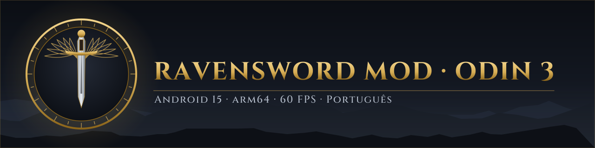

<p align="center"></p>

<p align="center"><a href="README.md">English</a> | <a href="README.pt-BR.md">Português</a> | <b>Español</b></p>

<p align="center">
  <a href="https://github.com/dfdx047/Ravensword-Revived/releases/latest"></a>
  <a href="https://github.com/dfdx047/Ravensword-Revived/releases/latest"></a>
  <a href="LICENSE"></a>
  
  <a href="https://discord.gg/YGEpECWrK7"></a>
  <a href="https://youtube.com/@dfdx47"></a>
</p>

# Ravensword Revived

Un mod hecho por un fan que devuelve **Ravensword: Shadowlands 1.26** a las consolas portátiles Android
actuales: el juego original de 32 bits funciona en Android 15 solo de 64 bits, con gráficos renovados,
60 FPS estables, soporte completo de mando y traducción al portugués de Brasil.

> [!IMPORTANT]
> **Probado SOLO en la AYN Odin 3 (Android 15, arm64-v8a).** En otros dispositivos puede que no se
> instale o que no abra. El soporte para más dispositivos llegará más adelante; por ahora no se ha
> probado nada más.

Este repositorio contiene solo el código y las herramientas del mod. **No incluye ningún archivo del
juego.** Necesitas tu propia copia del APK del juego; el patcher le aplica el mod en tu ordenador.

## Qué hace

- **Funciona en Android solo de 64 bits.** El código nativo del juego es ARM de 32 bits, que los
  dispositivos con Android 15 como la Odin 3 ya no pueden ejecutar. El mod sustituye `libunity.so` por
  un puente de 64 bits que ejecuta el código original de 32 bits con el JIT de
  [dynarmic](https://github.com/dfdx047/dynarmic), con libc, pthread, OpenGL ES y JNI implementados
  mediante thunks.
- **Gráficos renovados.** Escena en HDR con MSAA, bloom, oclusión ambiental, rayos de sol, nitidez y
  viñeta; superficie de color de 32 bits en lugar de la original de 16 (sin bandas en los degradados);
  sombras proyectadas de hasta 4096 px en lugar de 256 px, también en rocas y edificios.
- **60 FPS estables.** Ritmo de fotogramas con `APerformanceHint` y `eglPresentationTimeANDROID`, para
  que la CPU no baje la frecuencia entre fotogramas.
- **Ajustes dentro del juego.** Páginas nuevas de gráficos y de controles e idioma en el propio menú de
  opciones. Todo cambia en directo.
- **Mando y pantalla táctil a la vez**, con un marco dorado para navegar cualquier pantalla con la cruceta
  o el stick.
- **Traducción al portugués de Brasil** de 1.797 textos, con una fuente que ahora tiene tildes.

La facturación de Google Play y la biblioteca del mando MOGA están desactivadas: fallaban en el
Android actual.

> El juego modificado está en portugués o en inglés (se elige en el menú). No hay traducción al español.

## Capturas

| Gráficos | Controles e idioma |
|---|---|
|  |  |
| **Avanzado** | **Marco de navegación con mando** |
|  |  |

| Ultra | Bajo |
|---|---|
|  |  |


## Niveles de calidad

Cada nivel cambia solo lo que cuesta rendimiento. Color, contraste y exposición son iguales en todos.
La resolución y el límite de FPS son ajustes aparte (por defecto: nativa y 60).

| | Bajo | Medio | Alto | Muy alto | Ultra |
|---|---|---|---|---|---|
| Antialiasing | no | 2x | 4x | 4x | 8x |
| Texturas | mitad | completas | completas | completas | completas |
| Bloom | no | suave | medio | medio | medio |
| Oclusión ambiental | no | 30% | 50% | 70% | 80% |
| Nitidez | no | 20% | 30% | 30% | 30% |
| Distancia de dibujado | 450 m | 700 m | 700 m | 1000 m | 1000 m |
| Vegetación (alcance, densidad) | 20 m, 20% | 40 m, 50% | 80 m, 50% | 80 m, 100% | 120 m, 100% |
| Sombra proyectada (tamaño, alcance) | 512, 20 m | 512, 30 m | 1024, 45 m | 2048, 60 m | 2048, 60 m |

Medido en la Odin 3, en Aven Sur, con Ultra: 60,0 FPS quieto y 59,7 FPS caminando.

La página Avanzado tiene cada efecto en 11 pasos (apagado a 100%), exposición de 50% a 150%,
resolución de 360p a 2160p (los menús siempre quedan en la resolución nativa), alcance y tamaño de las
sombras, texturas, distancia de dibujado, niebla, vegetación, campo de visión, zona muerta, botones
táctiles e idioma.

## Requisitos

**Para jugar**

- AYN Odin 3 con Android 15 (arm64-v8a). Otros dispositivos no se han probado.
- Tu propia copia del APK de **Ravensword: Shadowlands 1.26**. El patcher solo acepta el archivo exacto
  para el que se hizo el mod (SHA-256 `bbdbab91f302b278458e443801f050582c0c5642b8065a73d07e71844daf71a9`).
  Nunca descarga el juego.

**Para ejecutar el patcher** (en un ordenador)

- Linux x86-64. En Windows se puede intentar con WSL2; no se ha probado.
- `bash`, `unzip`, `zip` y Python 3.
- [uv](https://docs.astral.sh/uv/), que descarga los paquetes de Python por sí mismo, o
  `pip install UnityPy==1.25.4 fonttools==4.68.0`.
- Un JDK de Java (para `keytool` y `apksigner`).
- Android SDK build-tools (`zipalign`, `apksigner`), que se buscan en `ANDROID_HOME` o `~/Android/Sdk`.
- `adb` para instalar el resultado, y unos 2 GB libres en disco.

## Instalación

1. Descarga `ravensword-odin3-mod-patcher-<versión>.zip` desde
   [Releases](https://github.com/dfdx047/Ravensword-Revived/releases/latest) y descomprímelo.
2. Ejecuta el patcher sobre tu APK:
   ```sh
   cd ravensword-odin3-mod-patcher-<versión>
   ./scripts/patch.sh /ruta/a/tu/ravensword-1.26.apk
   ```
   Comprueba el APK, aplica el mod, crea la fuente con tildes a partir de la fuente del propio APK,
   reconstruye la traducción a partir de los textos del propio APK y firma el resultado con una clave
   creada en tu ordenador (`keystore/patcher.jks`). El resultado es `output/ravensword-1.26-odin3-mod.apk`.
3. Instálalo en la Odin 3 con la depuración USB o inalámbrica activada:
   ```sh
   adb install output/ravensword-1.26-odin3-mod.apk
   ```
   Si hay otra versión del juego instalada, desinstálala antes. **Eso borra sus partidas guardadas.**
4. Guarda la carpeta `keystore/`. Con la misma clave, una versión futura se instala encima de esta sin
   perder las partidas.

En el juego, abre las opciones y entra en las páginas de gráficos y de controles e idioma. El idioma
puede ser Português o English; reinicia el juego para que se aplique a todos los textos.

## Compilar desde el código fuente

Solo para desarrollo. Necesita el Android NDK, CMake y Ninja; un .NET SDK local se instala en `tools/`
la primera vez.

```sh
git clone --recursive https://github.com/dfdx047/Ravensword-Revived.git
cd Ravensword-Revived
mkdir original && cp /ruta/a/tu/ravensword-1.26.apk original/ravensword-1.26-original.apk
scripts/build.sh            # o: scripts/build.sh --dev para una versión depurable
```

| Ruta | Contenido |
|---|---|
| `bridge/` | El `libunity.so` de 64 bits: cargador ELF, CPU dynarmic, thunks de libc/pthread/GL/JNI, posprocesado (`fx.cpp`) |
| `mod/RavenMod.cs` | Páginas de ajustes, niveles, entrada, navegación con mando, traducción |
| `scripts/patch_assemblies/` | Parches de IL para las bibliotecas del juego (Mono.Cecil) |
| `scripts/patch.sh` | El patcher que ejecuta el usuario |
| `scripts/*.py` | Parches de `classes.dex`, el manifiesto, los datos de Unity y la fuente; herramientas de la tabla de traducción |
| `lang/pt-BR.hashed.json` | La traducción, indexada por un hash de cada frase en inglés, para que el texto del juego no esté en este repositorio |
| `lang/padmap.txt` | Asignaciones del mando leídas de la escena de mando del juego |

## Problemas conocidos

- **Las zonas del juego completo siguen bloqueadas.** El juego vendía la versión completa en la tienda
  de OUYA, que ya no existe. El mod no cambia eso.
- **La tienda de objetos de pago del juego no funciona.** La facturación de Google Play está desactivada
  porque fallaba en el Android actual.
- **Bloqueo poco frecuente al abrir, con `Inflate Error`.** Aparecía cuando el mod llamaba a Java (JNI)
  en bucle, y el mod ya no lo hace: 31 aperturas y unos 15 minutos de juego sin fallos. La causa no se
  ha entendido del todo.
- Cambiar el tipo de sombra (ninguna, simple, proyectadas) se aplica al entrar en otra zona.
- **Solo se ha probado en la Odin 3.**

## Créditos

- **Crescent Moon Games**, por Ravensword: Shadowlands.
- **[dynarmic](https://github.com/dfdx047/dynarmic)** (fork del dynarmic de merryhime, 0BSD) y las
  bibliotecas que usa: mcl, oaknut, fmt, robin-map y Boost.
- **Mono.Cecil**, **UnityPy** y **fontTools**, que usa el patcher.
- El texto del banner usa la fuente **Cinzel** (SIL Open Font License).

Las licencias están en [THIRD_PARTY_NOTICES.md](THIRD_PARTY_NOTICES.md).

## Aviso legal

Este es un proyecto no oficial hecho por un fan. No tiene afiliación, aprobación ni relación con
Crescent Moon Games. "Ravensword" y "Ravensword: Shadowlands" son marcas de sus propietarios. Ni este
repositorio ni sus releases incluyen archivos del juego: para usar el mod necesitas tu propia copia del
juego. El código del mod se publica bajo la licencia de [LICENSE](LICENSE).
