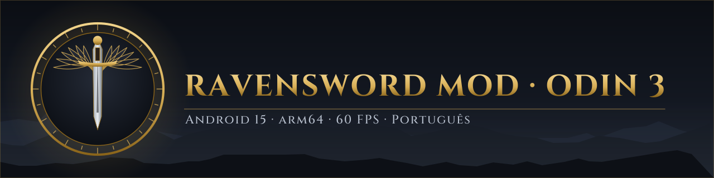

<p align="center"></p>

<p align="center"><b>English</b> | <a href="README.pt-BR.md">Português</a> | <a href="README.es.md">Español</a></p>

<p align="center">
  <a href="https://github.com/dfdx047/Ravensword-Revived/releases/latest"></a>
  <a href="https://github.com/dfdx047/Ravensword-Revived/releases/latest"></a>
  <a href="LICENSE"></a>
  
  <a href="https://discord.gg/YGEpECWrK7"></a>
  <a href="https://youtube.com/@dfdx47"></a>
</p>

# Ravensword Revived

A fan mod that brings **Ravensword: Shadowlands 1.26** back to life on current Android handhelds: the
original 32-bit game runs on 64-bit-only Android 15, with reworked graphics, a steady 60 FPS, full
gamepad support and a Brazilian Portuguese translation.

> [!IMPORTANT]
> **Tested only on the AYN Odin 3 (Android 15, arm64-v8a).** On other devices it may not install or
> may not start. Support for more devices may come later; for now, nothing else has been tested.

This repository contains only the mod's own code and tools. **No game files are included.** You
need your own copy of the game's APK; the patcher applies the mod to it on your computer.

## What it does

- **Runs on 64-bit-only Android.** The game's native code is 32-bit ARM, which Android 15 devices like
  the Odin 3 can no longer run. The mod replaces `libunity.so` with a 64-bit bridge that runs the
  game's original 32-bit code through the [dynarmic](https://github.com/dfdx047/dynarmic) JIT, with
  libc, pthread, OpenGL ES and JNI provided by thunks.
- **Reworked graphics.** HDR scene with MSAA, bloom, ambient occlusion, sun rays, sharpening and
  vignette; a 32-bit color surface instead of the original 16-bit one (no more banding); projected
  shadows up to 4096 px instead of 256 px, also on rocks and buildings.
- **Steady 60 FPS.** Frame pacing through `APerformanceHint` and `eglPresentationTimeANDROID`, so the
  CPU no longer clocks down between frames.
- **In-game settings.** New "Graphics" and "Controls & Language" pages inside the game's own Options
  menu. Everything changes live.
- **Gamepad and touch together**, with a gold frame that lets you navigate every screen with the
  D-pad or stick.
- **Brazilian Portuguese translation** of 1,797 lines, with a font that now has accented letters.

Google Play billing and the MOGA controller library are turned off: they crashed on current Android.

## Screenshots

| Graphics settings | Controls & Language |
|---|---|
|  |  |
| **Advanced** | **Gamepad navigation frame** |
|  |  |

| Ultra | Low |
|---|---|
|  |  |


## Quality presets

Each preset changes only what costs performance. Color, contrast and exposure are the same in all of
them. Resolution and the FPS limit are separate settings (defaults: native and 60).

| | Low | Medium | High | Very High | Ultra |
|---|---|---|---|---|---|
| Anti-aliasing | off | 2x | 4x | 4x | 8x |
| Textures | half | full | full | full | full |
| Bloom | off | light | medium | medium | medium |
| Ambient occlusion | off | 30% | 50% | 70% | 80% |
| Sharpening | off | 20% | 30% | 30% | 30% |
| Draw distance | 450 m | 700 m | 700 m | 1000 m | 1000 m |
| Vegetation (range, density) | 20 m, 20% | 40 m, 50% | 80 m, 50% | 80 m, 100% | 120 m, 100% |
| Projected shadow (size, range) | 512, 20 m | 512, 30 m | 1024, 45 m | 2048, 60 m | 2048, 60 m |

Measured on the Odin 3 in South Aven with Ultra: 60.0 FPS standing still and 59.7 FPS walking.

The Advanced page has every effect in 11 steps (off to 100%), exposure from 50% to 150%,
resolution from 360p to 2160p (menus always stay at native resolution), shadow range and size,
textures, draw distance, fog, vegetation, field of view, dead zone, touch buttons and language.

## Requirements

**To play**

- AYN Odin 3 with Android 15 (arm64-v8a). Other devices are untested.
- Your own copy of the **Ravensword: Shadowlands 1.26** APK. The patcher only accepts the exact file
  the mod was made for (SHA-256 `bbdbab91f302b278458e443801f050582c0c5642b8065a73d07e71844daf71a9`).
  It never downloads the game.

**To run the patcher** (on a computer)

- Linux x86-64. Windows users can try WSL2; it has not been tested.
- `bash`, `unzip`, `zip` and Python 3.
- [uv](https://docs.astral.sh/uv/), which fetches the Python packages by itself, or
  `pip install UnityPy==1.25.4 fonttools==4.68.0`.
- A Java JDK (for `keytool` and `apksigner`).
- Android SDK build-tools (`zipalign`, `apksigner`), found through `ANDROID_HOME` or `~/Android/Sdk`.
- `adb` to install the result, and about 2 GB of free disk space.

## Installing

1. Download `ravensword-odin3-mod-patcher-<version>.zip` from
   [Releases](https://github.com/dfdx047/Ravensword-Revived/releases/latest) and unzip it.
2. Run the patcher on your APK:
   ```sh
   cd ravensword-odin3-mod-patcher-<version>
   ./scripts/patch.sh /path/to/your/ravensword-1.26.apk
   ```
   It checks the APK, applies the mod, builds the accented font from the APK's own font, rebuilds the
   translation from the APK's own text, and signs the result with a key made on your computer
   (`keystore/patcher.jks`). The result is `output/ravensword-1.26-odin3-mod.apk`.
3. Install it on the Odin 3 with USB or wireless debugging on:
   ```sh
   adb install output/ravensword-1.26-odin3-mod.apk
   ```
   If another build of the game is installed, uninstall it first. **That erases its saves.**
4. Keep the `keystore/` folder. Patching a future version with the same key lets you install it over
   this one without losing your saves.

In the game, open **Options → Graphics** and **Options → Controls & Language**. The language can be
switched between Português and English; restart the game for it to apply everywhere.

## Building from source

For development only. Needs the Android NDK, CMake and Ninja; a local .NET SDK is installed into
`tools/` on first use.

```sh
git clone --recursive https://github.com/dfdx047/Ravensword-Revived.git
cd Ravensword-Revived
mkdir original && cp /path/to/your/ravensword-1.26.apk original/ravensword-1.26-original.apk
scripts/build.sh            # or: scripts/build.sh --dev for a debuggable build
```

| Path | Contents |
|---|---|
| `bridge/` | The 64-bit `libunity.so`: ELF loader, dynarmic CPU, libc/pthread/GL/JNI thunks, post-processing (`fx.cpp`) |
| `mod/RavenMod.cs` | In-game settings pages, presets, input, gamepad navigation, translation lookup |
| `scripts/patch_assemblies/` | IL patches for the game's assemblies (Mono.Cecil) |
| `scripts/patch.sh` | The patcher users run |
| `scripts/*.py` | Patches for `classes.dex`, the manifest, Unity data and the font; translation table tools |
| `lang/pt-BR.hashed.json` | The translation, keyed by a hash of each English line, so the game's text is not in this repository |
| `lang/padmap.txt` | Gamepad bindings read from the game's controller scene |

## Known issues

- **Areas of the full game stay locked.** The game sold the full version through the OUYA store,
  which no longer exists. This mod does not change that.
- **The in-game shop for paid items does not work.** Google Play billing is turned off because it
  crashed on current Android.
- **Rare hang at start with `Inflate Error`.** It appeared when the mod called Java (JNI) in a loop,
  and the mod no longer does that: 31 launches and about 15 minutes of play without a failure. The
  cause is not fully understood.
- Changing the shadow type (None, Simple, Projected) applies when you enter another area.
- **Only the Odin 3 has been tested.**

## Credits

- **Crescent Moon Games**, for Ravensword: Shadowlands.
- **[dynarmic](https://github.com/dfdx047/dynarmic)** (fork of merryhime's dynarmic, 0BSD), and the
  libraries it uses: mcl, oaknut, fmt, robin-map and Boost.
- **Mono.Cecil**, **UnityPy** and **fontTools**, which the patcher relies on.
- Banner text set in **Cinzel** (SIL Open Font License).

See [THIRD_PARTY_NOTICES.md](THIRD_PARTY_NOTICES.md) for licenses.

## Legal notice

This is an unofficial fan project. It is not affiliated with, endorsed by or connected to Crescent
Moon Games. "Ravensword" and "Ravensword: Shadowlands" are trademarks of their owners. No game files
are included in this repository or in its releases: to use the mod you need your own copy of the
game. The mod's own code is released under the GNU General Public License v3.0 (GPL-3.0); see
[LICENSE](LICENSE).
