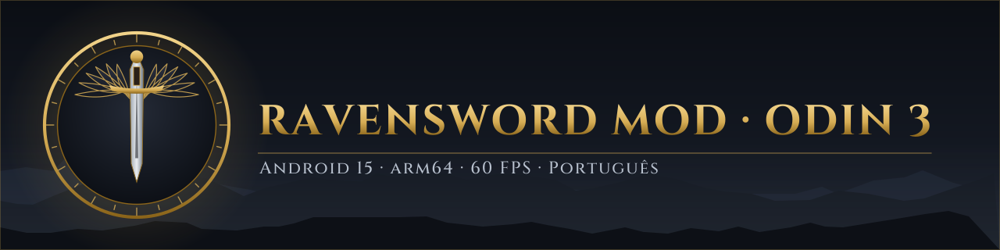

<p align="center"></p>

<p align="center"><a href="README.md">English</a> | <b>Português</b> | <a href="README.es.md">Español</a></p>

<p align="center">
  <a href="https://github.com/dfdx047/Ravensword-Revived/releases/latest"></a>
  <a href="https://github.com/dfdx047/Ravensword-Revived/releases/latest"></a>
  <a href="LICENSE"></a>
  
  <a href="https://discord.gg/YGEpECWrK7"></a>
  <a href="https://youtube.com/@dfdx47"></a>
</p>

# Ravensword Revived

Um mod feito por fã que traz o **Ravensword: Shadowlands 1.26** de volta aos portáteis Android de hoje:
o jogo original de 32 bits roda no Android 15 só 64 bits, com gráficos refeitos, 60 FPS estáveis,
suporte completo a controle e tradução para português do Brasil.

> [!IMPORTANT]
> **Testado SÓ no AYN Odin 3 (Android 15, arm64-v8a).** Em outros aparelhos pode não instalar ou não
> abrir. Correções para outros aparelhos virão depois; por enquanto, nada além do Odin 3 foi testado.

Este repositório tem só o código e as ferramentas do mod. **Nenhum arquivo do jogo está incluído.**
Você precisa da sua própria cópia do APK do jogo; o patcher aplica o mod nela, no seu computador.

## O que o mod faz

- **Roda no Android só 64 bits.** O código nativo do jogo é ARM de 32 bits, que aparelhos com Android 15
  como o Odin 3 não executam mais. O mod troca o `libunity.so` por uma ponte de 64 bits que executa o
  código original de 32 bits pelo JIT do [dynarmic](https://github.com/dfdx047/dynarmic), com libc,
  pthread, OpenGL ES e JNI implementados por thunks.
- **Gráficos refeitos.** Cena em HDR com MSAA, bloom, oclusão de ambiente, raios de sol, nitidez e
  vinheta; superfície de cor de 32 bits no lugar da original de 16 (sem faixas no degradê); sombras
  projetadas de até 4096 px no lugar de 256 px, também em pedras e prédios.
- **60 FPS estáveis.** Ritmo de quadros com `APerformanceHint` e `eglPresentationTimeANDROID`, para a CPU
  não baixar a frequência entre um quadro e outro.
- **Opções dentro do jogo.** Páginas novas "Gráficos" e "Controles e Idioma" no próprio menu Opções.
  Tudo muda ao vivo.
- **Controle e toque ao mesmo tempo**, com uma moldura dourada que navega qualquer tela pelo direcional
  ou analógico.
- **Tradução para português do Brasil** de 1.797 textos, com uma fonte que agora tem acentos.

As compras do Google Play e a biblioteca do controle MOGA ficam desligadas: elas quebravam no Android atual.

## Screenshots

| Gráficos | Controles e Idioma |
|---|---|
|  |  |
| **Avançado** | **Moldura de navegação por controle** |
|  |  |

| Ultra | Baixo |
|---|---|
|  |  |


## Níveis de qualidade

Cada nível muda só o que custa desempenho. Cor, contraste e exposição são iguais em todos.
Resolução e limite de FPS são opções à parte (padrão: da tela e 60).

| | Baixo | Médio | Alto | Muito Alto | Ultra |
|---|---|---|---|---|---|
| Anti-aliasing | sem | 2x | 4x | 4x | 8x |
| Texturas | metade | completas | completas | completas | completas |
| Bloom | sem | leve | médio | médio | médio |
| Oclusão de ambiente | sem | 30% | 50% | 70% | 80% |
| Nitidez | sem | 20% | 30% | 30% | 30% |
| Distância de render | 450 m | 700 m | 700 m | 1000 m | 1000 m |
| Vegetação (alcance, densidade) | 20 m, 20% | 40 m, 50% | 80 m, 50% | 80 m, 100% | 120 m, 100% |
| Sombra projetada (tamanho, alcance) | 512, 20 m | 512, 30 m | 1024, 45 m | 2048, 60 m | 2048, 60 m |

Medido no Odin 3, em Aven Sul, no Ultra: 60,0 FPS parado e 59,7 FPS andando.

A página Avançado tem cada efeito em 11 níveis (desligado a 100%), exposição de 50% a 150%,
resolução de 360p a 2160p (os menus ficam sempre na resolução nativa), alcance e tamanho das
sombras, texturas, distância de render, nevoeiro, vegetação, campo de visão, zona morta, botões de
toque e idioma.

## Requisitos

**Para jogar**

- AYN Odin 3 com Android 15 (arm64-v8a). Outros aparelhos não foram testados.
- A sua própria cópia do APK do **Ravensword: Shadowlands 1.26**. O patcher só aceita o arquivo exato
  para o qual o mod foi feito (SHA-256 `bbdbab91f302b278458e443801f050582c0c5642b8065a73d07e71844daf71a9`).
  Ele nunca baixa o jogo.

**Para rodar o patcher** (no computador)

- Linux x86-64. No Windows dá para tentar pelo WSL2, mas não foi testado.
- `bash`, `unzip`, `zip` e Python 3.
- [uv](https://docs.astral.sh/uv/), que baixa os pacotes de Python sozinho, ou
  `pip install UnityPy==1.25.4 fonttools==4.68.0`.
- Um JDK do Java (para o `keytool` e o `apksigner`).
- Android SDK build-tools (`zipalign`, `apksigner`), encontrado por `ANDROID_HOME` ou em `~/Android/Sdk`.
- `adb` para instalar o resultado, e cerca de 2 GB livres em disco.

## Como instalar

1. Baixe o `ravensword-odin3-mod-patcher-<versão>.zip` em
   [Releases](https://github.com/dfdx047/Ravensword-Revived/releases/latest) e descompacte.
2. Rode o patcher no seu APK:
   ```sh
   cd ravensword-odin3-mod-patcher-<versão>
   ./scripts/patch.sh /caminho/do/seu/ravensword-1.26.apk
   ```
   Ele confere o APK, aplica o mod, monta a fonte com acentos a partir da fonte do próprio APK,
   remonta a tradução a partir dos textos do próprio APK e assina o resultado com uma chave criada no
   seu computador (`keystore/patcher.jks`). O resultado é `output/ravensword-1.26-odin3-mod.apk`.
3. Instale no Odin 3 com a depuração USB ou sem fio ligada:
   ```sh
   adb install output/ravensword-1.26-odin3-mod.apk
   ```
   Se houver outra versão do jogo instalada, desinstale antes. **Isso apaga os saves dela.**
4. Guarde a pasta `keystore/`. Com a mesma chave, uma versão futura instala por cima desta sem perder
   os saves.

No jogo, abra **Opções → Gráficos** e **Opções → Controles e Idioma**. O idioma pode ser Português ou
English; reinicie o jogo para valer em todos os textos.

## Compilar do código-fonte

Só para desenvolvimento. Precisa do Android NDK, CMake e Ninja; um .NET SDK local é instalado em
`tools/` no primeiro uso.

```sh
git clone --recursive https://github.com/dfdx047/Ravensword-Revived.git
cd Ravensword-Revived
mkdir original && cp /caminho/do/seu/ravensword-1.26.apk original/ravensword-1.26-original.apk
scripts/build.sh            # ou: scripts/build.sh --dev para uma versão depurável
```

| Caminho | Conteúdo |
|---|---|
| `bridge/` | O `libunity.so` de 64 bits: carregador ELF, CPU dynarmic, thunks de libc/pthread/GL/JNI, pós-processamento (`fx.cpp`) |
| `mod/RavenMod.cs` | Páginas de opções, níveis, entrada, navegação por controle, tradução |
| `scripts/patch_assemblies/` | Patches de IL nas bibliotecas do jogo (Mono.Cecil) |
| `scripts/patch.sh` | O patcher que o usuário roda |
| `scripts/*.py` | Patches do `classes.dex`, do manifesto, dos dados do Unity e da fonte; ferramentas da tabela de tradução |
| `lang/pt-BR.hashed.json` | A tradução, indexada pelo hash de cada frase em inglês, para o texto do jogo não ficar neste repositório |
| `lang/padmap.txt` | Ligações do controle lidas da cena de controle do jogo |

## Problemas conhecidos

- **As áreas do jogo completo continuam bloqueadas.** O jogo vendia a versão completa pela loja da OUYA,
  que não existe mais. O mod não muda isso.
- **A loja de itens pagos dentro do jogo não funciona.** As compras do Google Play ficam desligadas
  porque quebravam no Android atual.
- **Travamento raro ao abrir, com `Inflate Error`.** Aparecia quando o mod chamava o Java (JNI) em ciclo,
  e o mod não faz mais isso: 31 aberturas e cerca de 15 minutos de jogo sem falha. A causa não foi
  totalmente entendida.
- Trocar o tipo de sombra (Nenhuma, Simples, Projetadas) só vale ao entrar em outra área.
- **Só o Odin 3 foi testado.**

## Créditos

- **Crescent Moon Games**, pelo Ravensword: Shadowlands.
- **[dynarmic](https://github.com/dfdx047/dynarmic)** (fork do dynarmic de merryhime, 0BSD) e as
  bibliotecas que ele usa: mcl, oaknut, fmt, robin-map e Boost.
- **Mono.Cecil**, **UnityPy** e **fontTools**, usados pelo patcher.
- O texto do banner usa a fonte **Cinzel** (SIL Open Font License).

As licenças estão em [THIRD_PARTY_NOTICES.md](THIRD_PARTY_NOTICES.md).

## Aviso legal

Este é um projeto de fã, não oficial. Não tem afiliação, aprovação nem ligação com a Crescent Moon
Games. "Ravensword" e "Ravensword: Shadowlands" são marcas dos seus donos. Nenhum arquivo do jogo está
incluído neste repositório nem nas releases: para usar o mod é preciso ter a sua própria cópia do
jogo. O código do mod é distribuído sob a GNU General Public License v3.0 (GPL-3.0); veja
[LICENSE](LICENSE).
